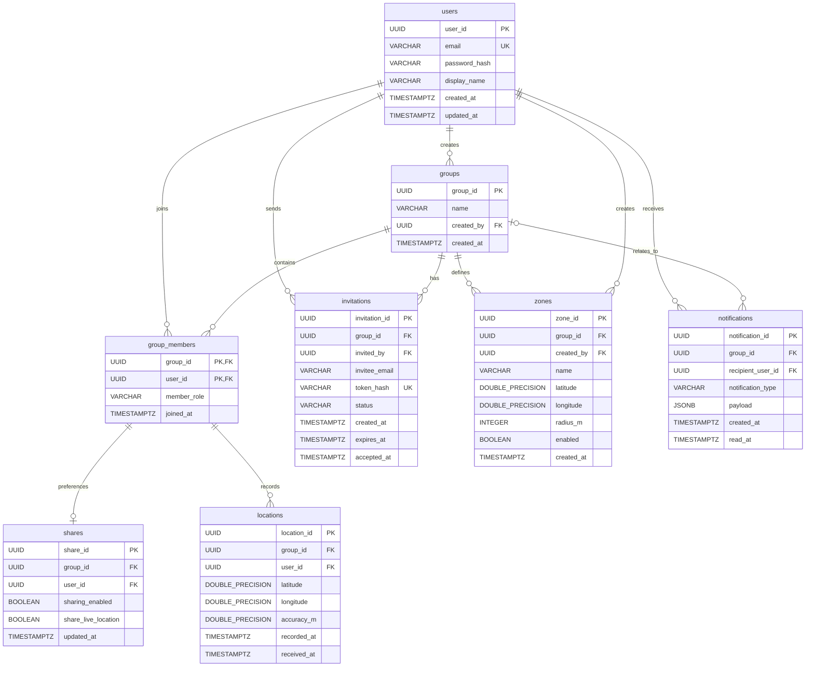

# CloseCircle database schema

This document describes the PostgreSQL schema created by Flyway migration [`V1__initial_schema.sql`](../backend/src/main/resources/db/migration/V1__initial_schema.sql). Treat that migration as the source of truth when implementing persistence. This is the initial schema; update this document alongside any later migration that changes it.

## Entity relationship diagram

`UK` denotes a unique constraint or index. `group_members` has a composite primary key `(group_id, user_id)`. In `shares` and `locations`, the `(group_id, user_id)` pair references that membership key, so a share preference or location cannot be stored for a user who is not a member of that group.

## Tables and implementation notes

### `users`

| Column | Type | Rules / purpose |
| --- | --- | --- |
| `user_id` | `UUID` | Primary key; generated by PostgreSQL. |
| `email` | `VARCHAR(320)` | Required; unique case-insensitively via `lower(email)`. |
| `password_hash` | `VARCHAR(255)` | Required; store a password hash, never the raw password. |
| `display_name` | `VARCHAR(100)` | Required and non-empty after trimming. |
| `created_at`, `updated_at` | `TIMESTAMPTZ` | Required; default to current time. |

The database sets `updated_at` on insert only. The application must set it explicitly when updating a user; V1 has no update trigger.

### `groups`

| Column | Type | Rules / purpose |
| --- | --- | --- |
| `group_id` | `UUID` | Primary key; generated by PostgreSQL. |
| `name` | `VARCHAR(100)` | Required and non-empty after trimming. |
| `created_by` | `UUID` | Required FK to `users.user_id`; deletion is restricted. |
| `created_at` | `TIMESTAMPTZ` | Required; defaults to current time. |

The FK only checks that the creator user exists; it does not add that user to `group_members`. The service should create the group and the creator's membership with `member_role = 'OWNER'` together in one transaction. Set the role explicitly: the database default is `MEMBER`.

### `group_members`

| Column | Type | Rules / purpose |
| --- | --- | --- |
| `group_id` | `UUID` | FK to `groups.group_id`; cascades on group deletion. |
| `user_id` | `UUID` | FK to `users.user_id`; cascades on user deletion. |
| `member_role` | `VARCHAR(20)` | Required; defaults to `MEMBER`; allowed values: `OWNER`, `ADMIN`, `MEMBER`. |
| `joined_at` | `TIMESTAMPTZ` | Required; defaults to current time. |

The primary key is `(group_id, user_id)`, allowing a user to belong to multiple groups while appearing at most once in each group.

### `invitations`

| Column | Type | Rules / purpose |
| --- | --- | --- |
| `invitation_id` | `UUID` | Primary key; generated by PostgreSQL. |
| `group_id` | `UUID` | Required FK to `groups.group_id`; cascades on group deletion. |
| `invited_by` | `UUID` | Required FK to `users.user_id`; deletion is restricted. |
| `invitee_email` | `VARCHAR(320)` | Required; has a case-insensitive lookup index. |
| `token_hash` | `VARCHAR(255)` | Required and unique; persist a hash, not the raw invitation token. |
| `status` | `VARCHAR(20)` | Required; defaults to `PENDING`; allowed values: `PENDING`, `ACCEPTED`, `REVOKED`, `EXPIRED`. |
| `created_at`, `expires_at` | `TIMESTAMPTZ` | Required; expiry must be later than creation. |
| `accepted_at` | `TIMESTAMPTZ` | Nullable; must be set exactly when status is `ACCEPTED`. |

There is intentionally no FK from `invitee_email` to `users`: an invite can be created before its recipient has an account.
The FK on `invited_by` only checks that the sender exists; check group membership and role in the service layer.

### `shares`

| Column | Type | Rules / purpose |
| --- | --- | --- |
| `share_id` | `UUID` | Primary key; generated by PostgreSQL. |
| `group_id`, `user_id` | `UUID` | Together reference `(group_id, user_id)` in `group_members`; cascade when membership is removed. |
| `sharing_enabled` | `BOOLEAN` | Required; defaults to `TRUE`. |
| `share_live_location` | `BOOLEAN` | Required; defaults to `TRUE`. |
| `updated_at` | `TIMESTAMPTZ` | Required; defaults to current time. |

There can be at most one settings row per `(group_id, user_id)` pair. The `share_id` is the primary key; the pair also has a unique constraint.

Creating a membership does not automatically create a `shares` row. The `TRUE` defaults apply only when a row is inserted and the corresponding values are omitted; they do not establish consent. The meaning of a missing row and the initial sharing and consent policy must be agreed by the team before exposing locations. Until then, do not assume that an absent row grants visibility. The application must also set `updated_at` explicitly when updating sharing settings; V1 has no update trigger.

### `locations`

| Column | Type | Rules / purpose |
| --- | --- | --- |
| `location_id` | `UUID` | Primary key; generated by PostgreSQL. |
| `group_id`, `user_id` | `UUID` | Together reference group membership; cascade when membership is removed. |
| `latitude`, `longitude` | `DOUBLE PRECISION` | Required; constrained to `[-90, 90]` and `[-180, 180]`. |
| `accuracy_m` | `DOUBLE PRECISION` | Nullable; if set, must be non-negative. Unit is metres. |
| `recorded_at` | `TIMESTAMPTZ` | Required; time supplied for when the location was recorded. |
| `received_at` | `TIMESTAMPTZ` | Required; defaults to current time when received by the server. |

An index supports reading a member's locations in a group ordered by `recorded_at` descending. The schema has no PostGIS geometry column; coordinates are stored as numeric latitude/longitude.

### `zones`

| Column | Type | Rules / purpose |
| --- | --- | --- |
| `zone_id` | `UUID` | Primary key; generated by PostgreSQL. |
| `group_id` | `UUID` | Required FK to `groups.group_id`; cascades on group deletion. |
| `created_by` | `UUID` | Required FK to `users.user_id`; deletion is restricted. |
| `name` | `VARCHAR(100)` | Required and non-empty after trimming. |
| `latitude`, `longitude` | `DOUBLE PRECISION` | Required; constrained to valid coordinate ranges. |
| `radius_m` | `INTEGER` | Required; between 10 and 100,000 metres. |
| `enabled` | `BOOLEAN` | Required; defaults to `TRUE`. |
| `created_at` | `TIMESTAMPTZ` | Required; defaults to current time. |

The database FK ensures the group and creator both exist, but does not itself enforce that `created_by` is a member of `group_id`; enforce that authorization rule in the service layer unless a later migration adds a stronger constraint.

### `notifications`

| Column | Type | Rules / purpose |
| --- | --- | --- |
| `notification_id` | `UUID` | Primary key; generated by PostgreSQL. |
| `group_id` | `UUID` | Nullable FK to `groups.group_id`; set to `NULL` if the group is deleted. |
| `recipient_user_id` | `UUID` | Required FK to `users.user_id`; cascades on user deletion. |
| `notification_type` | `VARCHAR(40)` | Required and non-empty after trimming. |
| `payload` | `JSONB` | Required; defaults to an empty JSON object. |
| `created_at` | `TIMESTAMPTZ` | Required; defaults to current time. |
| `read_at` | `TIMESTAMPTZ` | Nullable; `NULL` means unread. |

A partial index supports listing a recipient's unread notifications by newest first.

## Delete behavior

- Deleting a group cascades to its memberships, invitations, and zones; shares and locations cascade through the membership FK. Notifications keep their row and have `group_id` set to `NULL`.
- Deleting a membership cascades to that member's share settings and location records for that group.
- Deleting a user cascades to their memberships and received notifications. Group creator, invitation sender, and zone creator references use `RESTRICT` and must be handled before deleting the user.

## Persistence workflow

- Flyway applies versioned SQL from `backend/src/main/resources/db/migration/`.
- Add a new migration such as `V2__...sql` for schema changes; do not edit an already-applied migration in a shared database.
- Hibernate uses `ddl-auto: validate`, so it checks mappings against the migrated database and does not create or modify tables.
- The current Java backend source has the migration and database/security configuration, but no persistence entity or repository classes yet; use this document and V1 as the mapping guide when implementing them.
- Keep API JSON contracts separate from table structure. See [`api-contract.md`](api-contract.md); its business endpoints are a draft and are not implied by the existence of these tables.
